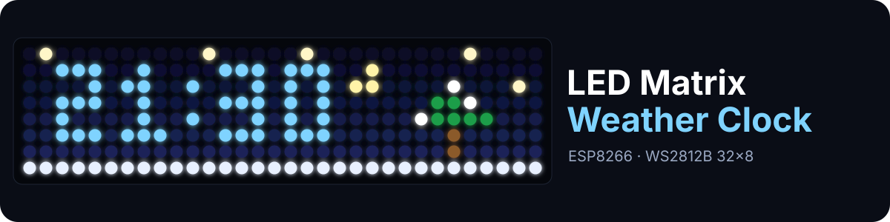
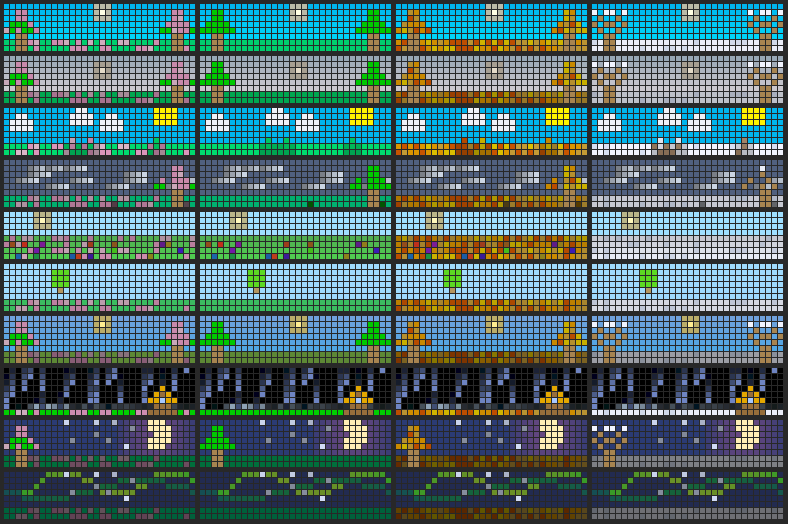
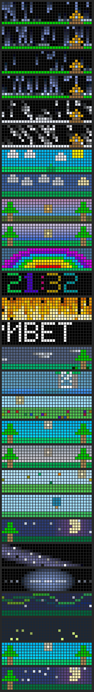

<p align="center">
  
</p>

<p align="center">
  <b>An animated weather clock on a 32×8 WS2812B LED matrix, powered by an ESP8266.</b><br>
  Live weather scenes, a clock, a ticker, a sunrise alarm and four seasons, all controlled by a touch button or from your phone.
</p>

<p align="center">
  
  
  
  
  
  
</p>

> [!WARNING]
> **🚧 Work in progress.** This project is under active development. The firmware works on real hardware,
> but features, settings and the web UI still change, and some things may be unfinished or break between versions.

<p align="center">
  <a href="https://the-volador42.github.io/led-matrix-weather-clock/simulator/simulator.html"><b>▶ Try the simulator in your browser</b></a> •
  <a href="#-features">Features</a> •
  <a href="#-hardware">Hardware</a> •
  <a href="#-flashing">Flashing</a> •
  <a href="#-firmware-layout">Firmware</a>
</p>

---

## 🌦️ Scenes in four seasons

<p align="center">
  
  <br><sub>Every scene in spring · summer · autumn · winter, rendered by the simulator from the real firmware code.</sub>
</p>

---

## ✨ Features

| | |
|---|---|
| 🌧️ **Live weather** | Rain, thunderstorm, drizzle, snow, sun with clouds, overcast, picked from [OpenWeatherMap](https://openweathermap.org). |
| 🎨 **28 effects** | Sunset, sunrise, rainbow, fire, wind with a living tree, waterfall, meadow, butterflies, hot-air balloon, starry night, Milky Way, quasar, aurora, fireflies… |
| 🍂 **Four seasons** | Grass and trees change in every scene: spring blossoms, green summer, falling autumn leaves, snowy winter. Picked by date or pinned manually. |
| 🕐 **Clock & ticker** | Accurate time over NTP and a scrolling text with a Cyrillic + Latin font. |
| ⏰ **Sunrise alarm** | Light slowly rises for 20 minutes before the alarm time. |
| 🌙 **Night mode** | Dims the matrix on a schedule (works across midnight). |
| 📱 **Phone setup** | No Wi-Fi yet? The clock opens a **LED-Clock-xxxx** hotspot with a setup page. |
| 🧊 **Glass web UI** | `http://ledclock.local`: brightness, modes, every effect, ticker, alarm, city, weather key, Wi-Fi. A live blurred image of the matrix sits behind the page. |
| 📡 **OTA updates** | Flash new firmware over Wi-Fi from the Arduino IDE or by uploading a `.bin`. |
| 🔌 **Power limit** | FastLED current limit (1.8 A by default for a 5 V 2 A supply). |
| 🖥️ **Simulator** | The same C++ effects compiled to WebAssembly, so you can watch them in a browser without the hardware. |

<details>
<summary><b>All effects in one picture</b></summary>
<p align="center"></p>
</details>

---

## 🔧 Hardware

| Part | Notes |
|---|---|
| **Wemos D1 mini** (ESP8266) | Board: *LOLIN(WEMOS) D1 R2 & mini* |
| **WS2812B matrix 32×8** | Data on GPIO 5 (D1) |
| **Touch button** | GPIO 14 (D5) |
| **5 V power supply** | 2 A or more. Raise `LED_MAX_MILLIAMPS` in `config.h` for a bigger supply |

### Touch button

| Gesture | Action |
|---|---|
| 1 tap | Screen on / off |
| 2 taps | Next mode (clock → fire → demo → weather) |
| 3 taps | Demo |
| Hold | Brightness (each new hold flips the direction) |
| Any tap during sunrise | Turn the alarm off |

---

## ⚡ Flashing

1. Open `led_matrix_weather_clock/led_matrix_weather_clock.ino` in the Arduino IDE.
2. Install the libraries **FastLED** and **ArduinoJson** (tested with esp8266 core 3.1.2, FastLED 3.10.6, ArduinoJson 7.4.3).
3. Board: **LOLIN(WEMOS) D1 R2 & mini**, Flash Size with FS: *4MB (FS:2MB OTA:~1019KB)*. Settings are stored there.
4. Upload.

### First Wi-Fi setup

- **From the phone:** the clock creates an open network **LED-Clock-xxxx** and scrolls its name. Connect to it, pick your home network on the page that opens (or go to `http://192.168.4.1`).
- **Or at build time:** copy `secrets.example.h` to `secrets.h` next to the `.ino` and fill in Wi-Fi and the weather key. `secrets.h` is in `.gitignore`.

After connecting, the clock scrolls its IP address. Open **http://ledclock.local**.

### Over-the-air updates

- **Arduino IDE:** Tools → Port → *ledclock at 192.168.…* → Upload. Default password `ledclock` (change it in the web UI → System).
- **File upload:** Sketch → Export compiled binary, then open `http://ledclock.local/update`.

A blue progress bar runs on the matrix while flashing.

---

## 🖥️ Simulator

<a href="https://the-volador42.github.io/led-matrix-weather-clock/simulator/simulator.html"><b>Open it online</b></a> or double-click `simulator/simulator.html`.
It runs **the same C++ effect code** as the ESP8266, compiled to WebAssembly with Arduino and FastLED shims.

- Pick effects with a click or <kbd>←</kbd> <kbd>→</kbd>; <kbd>Space</kbd> pauses, <kbd>.</kbd> steps one frame, <kbd>R</kbd> restarts, speed ×¼…×16.
- Set wind, season, ticker text, date and time.
- Hover an LED to see its coordinates, strip index and color.
- See the current draw of each effect at the chosen brightness.

Rebuild after editing effects: `simulator/build.bat` (needs `python -m pip install ziglang` once).

---

## 🧩 Firmware layout

```text
led_matrix_weather_clock/
├── led_matrix_weather_clock.ino   # setup() and loop()
├── config.h                       # pins, intervals, current limit
├── settings.*                     # settings from the web UI, saved to flash
├── effects.*                      # ⭐ single list of effects: name, frame, reset
├── fx_weather.cpp                 # rain, storm, snow, sun, clouds
├── fx_sky.cpp                     # stars, moon, sunset, sunrise
├── fx_wind.cpp                    # wind with a living tree
├── fx_nature.cpp                  # day scenes: waterfall, meadow, butterflies, balloon
├── fx_night.cpp                   # night scenes: Milky Way, quasar, aurora, fireflies
├── fx_misc.cpp                    # rainbow, clock, fire, ticker
├── fx_cycles.cpp                  # auto-rotation of day and night scenes
├── matrix.*                       # LEDs, setPixel(x, y, color), font
├── scene.*                        # trees, house, sun, seasonal colors
├── modes.*                        # modes, demo, night dimming, notifications
├── alarm.*                        # sunrise alarm
├── weather.*                      # weather request and effect choice
├── network.*                      # Wi-Fi, NTP, phone setup, OTA
├── web.*, web_page.h              # web UI
└── button.*                       # touch button
```

### Adding an effect

1. Write `void myEffect()` (and optionally `void resetMy()`) in a matching `fx_*.cpp`.
2. Declare them in `effects.h` and add a name to `enum EffectId`.
3. Add a row to `EFFECTS[]` in `effects.cpp` at the same position. The build stops with a clear error if you forget.
4. Rebuild the simulator and check the effect in the browser.

---

## ✅ Checks

| Command | What it does |
|---|---|
| `check_firmware.bat` | Compiles the firmware for ESP8266 with `arduino-cli` |
| `tests\run_tests.bat` | Alarm and night-schedule tests on the PC (including across midnight) |
| `simulator\build.bat` | Builds the simulator from the same effect files |
| `node simulator/tools/golden.mjs compare simulator/sim.wasm simulator/tools/golden.json` | Compares every effect frame by frame with a reference |
| `node tools/web_mock.mjs` | Runs the web UI without the clock at `http://localhost:8080` (`--portal` for the Wi-Fi setup page) |

---

## 📁 Repository

| Folder | Contents |
|---|---|
| `led_matrix_weather_clock/` | Firmware |
| `simulator/` | Browser simulator |
| `tests/` | PC-side tests |
| `tools/` | Web UI mock |
| `archive/v1_original/` | The original single-file version, for reference |
